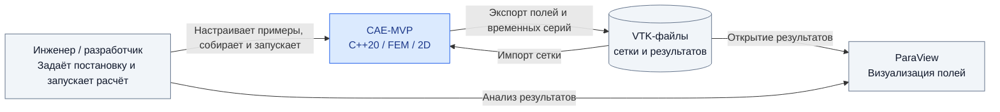
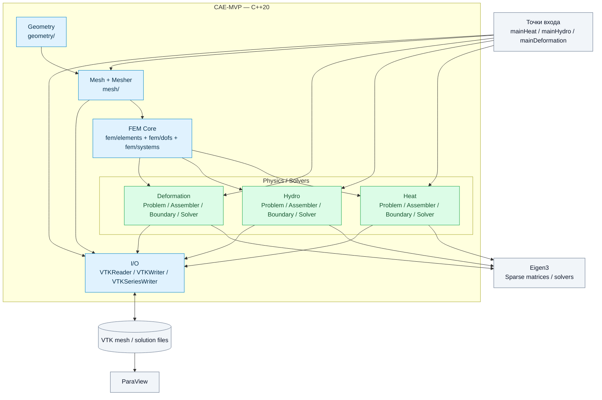
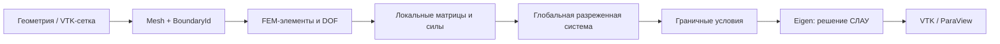

# CAE-MVP

**CAE-MVP** — учебно-исследовательский прототип двумерной системы инженерного анализа (Computer-Aided Engineering), реализованный на **C++20** с использованием **метода конечных элементов (МКЭ / FEM)** и библиотеки **Eigen**.

Проект охватывает полный базовый цикл численного моделирования: геометрия или импорт сетки → конечно-элементная дискретизация → физическая постановка → сборка разреженной системы → численное решение → экспорт результатов в **VTK / ParaView**.

Реализованы три независимые физические задачи: стационарная теплопроводность, нестационарная гидродинамика несжимаемой жидкости и динамическая линейная упругость. Для сборки систем теплопроводности и гидродинамики реализованы многопоточные вычисления на CPU.

> **Статус:** исследовательский MVP, а не готовый промышленный CAE-пакет. В репозитории находятся демонстрационные сценарии и базовые проверки; полноценная система автоматизированного тестирования и графический интерфейс отсутствуют.

## Содержание

- [Возможности](#возможности)
- [Архитектура — C4](#архитектура--c4)
- [Структура проекта](#структура-проекта)
- [Физические модели](#физические-модели)
- [Многопоточность](#многопоточность)
- [Сборка и запуск](#сборка-и-запуск)∏
- [Результаты и визуализация](#результаты-и-визуализация)
- [Проверка корректности и ограничения](#проверка-корректности-и-ограничения)
- [Документация](#документация)

## Возможности

| Подсистема | Реализация |
|---|---|
| Геометрия | Прямоугольник, окружность, прямоугольник с отверстием; контуры из прямых и дуг |
| Сетка | Узлы, треугольники, граничные рёбра и идентификаторы границ; генератор прямоугольной сетки, импорт VTK |
| МКЭ | Линейные треугольники P1, квадратичные P2, квадратуры, отображения степеней свободы (DOF) |
| Теплопроводность | Стационарная задача, объёмный источник, граничные условия Дирихле, Неймана, Робина |
| Гидродинамика | Нестационарное несжимаемое течение; Taylor–Hood P2/P1, массовая, вязкостная и конвективная матрицы |
| Деформация | Динамическая двумерная линейная упругость, перемещения и скорости; интегрирование по времени методом Ньюмарка |
| Линейная алгебра | Разреженные матрицы Eigen; SparseLU, SimplicialLDLT (для подходящих постановок) |
| Параллелизм | Разделение элементов между CPU-потоками при сборке тепловой и гидродинамической систем |
| Ввод/вывод | Чтение сетки VTK, запись результатов VTK и временных серий для ParaView |

## Архитектура — C4

Ниже приведены два уровня модели **C4**: контекст системы (**Level 1**) и компоненты внутри приложения (**Level 3**, сгруппированные по подсистемам). Поскольку проект пока представляет собой единое C++-приложение с несколькими исполняемыми примерами и библиотеками, отдельные микросервисы или внешние контейнеры здесь не выдумываются.

### C4 — Level 1: System Context



### C4 — Level 3: Component Diagram



**Примечание к диаграмме:** стрелки показывают концептуальный поток данных и основные зависимости, а не полный граф `#include` или линковки CMake. Модуль деформации сейчас использует последовательную сборку; многопоточность применяется к теплопроводности и гидродинамике.

### Типовой поток расчёта



## Структура проекта

```text
CAE-MVP/
├── README.md                        # этот файл
└── src/
    ├── CMakeLists.txt               # цели и зависимости CMake
    ├── build.sh                     # сборка и запуск примеров
    ├── mainHeat.cpp                 # демонстрация теплопроводности
    ├── mainHydro.cpp                # демонстрация гидродинамики
    ├── mainDeformation.cpp          # демонстрация динамики деформации
    ├── LogDuration.h                # простой таймер
    ├── geometry/                    # фигуры, контуры, координаты
    ├── mesh/
    │   └── generators/             # структура сетки и генераторы
    ├── fem/
    │   ├── elements/               # TriangleP1 / TriangleP2
    │   ├── dofs/                   # P2DofMap / TaylorHoodDofMap
    │   └── systems/                # LinearSystem
    ├── physics/
    │   ├── heat/
    │   │   ├── problem/             # постановка тепловой задачи
    │   │   └── assembly/            # объёмная и граничная сборка
    │   ├── hydro/
    │   │   ├── problem/             # постановка течения
    │   │   └── assembly/            # массовая, вязкостная, конвективная сборка
    │   └── deformation/
    │       ├── problem/             # параметры упругости и нагрузки
    │       └── assembly/            # сборка и граничные условия
    ├── io/                          # чтение / запись VTK, серии кадров
    ├── docs/                        # дополнительные архитектурные заметки
    └── solutions/                   # примеры результатов
```

В архиве присутствуют также `.vtk`-файлы исходных сеток в `src/`. Каталоги результатов создаются или используются примерами при запуске.

## Физические модели

### 1. Стационарная теплопроводность

Решается уравнение

$$
-\nabla\cdot(\lambda\nabla T)=f\quad\text{в }\Omega,
$$

где $T$ — температура, $\lambda$ — коэффициент теплопроводности, $f$ — объёмный источник. Поддерживаются условия Дирихле, Неймана и Робина. Пространственная дискретизация — линейные треугольные элементы **P1**.

В `mainHeat.cpp` используется прямоугольная область с температурами $100$ и $200$ на противоположных сторонах. Для нулевого источника проверяется аналитическое решение

$$
T(x,y)=100+100\frac{x}{L}.
$$

### 2. Нестационарная гидродинамика

Рассматривается несжимаемая ньютоновская жидкость:

$$
\rho\left(\frac{\partial\mathbf{u}}{\partial t}+(\mathbf{u}\cdot\nabla)\mathbf{u}\right)
-\nabla\cdot\left(2\mu D(\mathbf{u})\right)+\nabla p=\mathbf f,
$$

$$
\nabla\cdot\mathbf{u}=0,\qquad
D(\mathbf{u})=\frac{\nabla\mathbf{u}+\nabla\mathbf{u}^{T}}{2}.
$$

Используются смешанные элементы **Taylor–Hood**: квадратичные **P2** для скорости и линейные **P1** для давления. На временном шаге собираются матрицы массы, вязкости, связи скорости с давлением и конвекции; конвективный оператор линеаризуется по скорости предыдущего шага. Система решается через `Eigen::SparseLU`.

`mainHydro.cpp` демонстрирует течение в канале с круглым препятствием на импортированной VTK-сетке. Выводятся последовательные кадры для ParaView.

### 3. Динамическая линейная упругость

Модуль `physics/deformation/` моделирует перемещения упругого тела с плотностью $\rho$, модулем Юнга $E$ и коэффициентом Пуассона $\nu$. Используются линейные треугольные элементы **P1** и временное интегрирование по **Ньюмарку** ($\beta=1/4$, $\gamma=1/2$).

В `mainDeformation.cpp` реализован пример изгиба консольной балки под нагрузкой на свободном конце. В VTK сохраняются поля перемещения и скорости.

## Многопоточность

Параллелизм применяется **на этапе сборки локальных конечно-элементных вкладов** для теплопроводности и гидродинамики:

1. Множество элементов разбивается на непересекающиеся диапазоны.
2. CPU-потоки независимо вычисляют локальные матрицы и векторы.
3. Каждый поток записывает результаты в собственные участки буферов либо возвращает локальные результаты через `future`.
4. После завершения задач выполняется формирование глобальных разреженных матриц и накопление правых частей.

В коде используются средства стандартной библиотеки C++ (`std::thread` / `std::jthread`, `std::async`, `std::future`, `std::packaged_task` — в соответствующих ассемблерах). Отсутствие общей записи в одни и те же локальные слоты позволяет избежать мьютексов в основной части сборки.

**Граница ускорения:** сборка распараллелена, но численная факторизация в используемом `Eigen::SparseLU` остаётся отдельным узким местом. Число потоков не означает, что весь расчёт масштабируется линейно.

### Пример профилирования гидродинамики

Ниже — результаты одного набора запусков на **894 элементах, 16 временных шагах**. Они иллюстрируют поведение именно этой тестовой конфигурации, а не универсальные характеристики алгоритма.

| Потоки | Сборка, мс | Полный расчёт, мс | Ускорение сборки | Ускорение расчёта |
|---:|---:|---:|---:|---:|
| 1 | 2286.295 | 16831.010 | 1.00× | 1.00× |
| 5 | 853.558 | 15389.765 | 2.68× | 1.09× |
| 10 | 670.830 | 15183.566 | 3.41× | 1.11× |

При отдельном профилировании на пяти потоках `SparseLU::compute()` занял около **13.1 с из 15.36 с** общего времени. Поэтому проект демонстрирует эффективность параллельной сборки и одновременно ограничение общего ускорения по закону Амдала.

## Сборка и запуск

### Требования

- **CMake 3.20+**;
- компилятор с поддержкой **C++20** (AppleClang, Clang или GCC);
- **Eigen3** с доступным для CMake пакетом `Eigen3Config.cmake`;
- **ParaView** — необязателен, нужен для просмотра результатов.

CUDA, MPI и графический интерфейс для запуска примеров не требуются.

### CMake

Все команды ниже выполняются **из корня репозитория**, где лежит этот README. Обрати внимание: `CMakeLists.txt` находится в `src/`.

```bash
cmake -S src -B build -DCMAKE_BUILD_TYPE=Release
cmake --build build --parallel
```

Исполняемые файлы при таком способе сборки находятся в `build/`:

```bash
./build/cae_heat
./build/cae_hydro
./build/cae_deform
```

**Рабочий каталог имеет значение.** Демонстрационные программы используют относительные пути к сеткам и результатам. В частности, гидродинамический пример ожидает `channel_hole_L006_under800.vtk` в текущем рабочем каталоге. Поэтому для запуска готовых примеров удобно перейти в `src/`:

```bash
cd src
../build/cae_heat
../build/cae_hydro
../build/cae_deform
```

### Скрипт `build.sh`

Существующий скрипт находится в `src/build.sh`. Он настраивает **Debug**-сборку и помещает исполняемые файлы в текущий каталог при запуске из `src/`.

```bash
cd src
bash build.sh build all
bash build.sh run heat
bash build.sh run hydro
bash build.sh run deform
```

Доступна очистка: `bash build.sh clean`. Для измерения производительности рекомендуется **Release**, а не Debug; приведённый выше вариант CMake позволяет выбрать `Release` явно.

### Цели CMake

| Исполняемый файл | CMake-цель | Назначение |
|---|---|---|
| `cae_heat` | `cae_heat_app` | Теплопроводность |
| `cae_hydro` | `cae_hydro_app` | Гидродинамика |
| `cae_deform` | `cae_deform_app` | Динамическая упругость |

Библиотеки: `cae_geometry`, `cae_mesh`, `cae_fem`, `cae_io`, `cae_heat`, `cae_hydro`, `cae_deform`.

## Результаты и визуализация

- **Heat:** поле температуры в `solutions/heat/temperature.vtk`.
- **Hydro:** последовательность VTK-кадров и файл временной серии в каталоге, заданном при вызове `HydroSolver::Solve()`.
- **Deformation:** VTK-кадры перемещений и скоростей; в демонстрационном сценарии — `solutions/deformation/beam`.

Относительные пути указаны относительно **рабочего каталога процесса**, а не местоположения README.

Для просмотра откройте `.vtk` или файл серии в **ParaView** через **File → Open → Apply**. Для гидродинамики доступны поля скорости и давления; для деформации удобно использовать фильтр **Warp By Vector** с полем `Displacement`.

## Проверка корректности и ограничения

**Имеющиеся проверки:** в тепловом примере численное решение сравнивается с аналитическим линейным профилем. Гидродинамика и деформация представлены демонстрационными сценариями; для них требуется отдельная систематическая верификация по эталонным решениям и сходимости по сетке и шагу времени.

**Для многопоточности:** полезный регрессионный тест — сравнение последовательной и параллельной сборки матриц и правых частей по относительной норме, а также сравнение итоговых полей. Совпадение результатов с точностью до допустимой ошибки важнее одного лишь ускорения.

**Текущие ограничения:**

- Только **2D**; универсального 3D-решателя нет.
- Нет GUI, полноценного CAD-ядра и автоматической адаптации сетки.
- Генерация сетки не является универсальным meshing-движком для произвольной геометрии.
- Не реализован общий промышленный конвейер тестирования и оценки погрешности.
- Прямая факторизация разреженных систем может доминировать по времени при увеличении задачи.
- Параллельная сборка реализована не для всех физических модулей.

## Документация

Внутри `src/` находятся дополнительные README отдельных подсистем и заметки по архитектуре:

- [`src/geometry/README.md`](src/geometry/README.md)
- [`src/mesh/README.md`](src/mesh/README.md)
- [`src/fem/README.md`](src/fem/README.md)
- [`src/physics/heat/README.md`](src/physics/heat/README.md)
- [`src/physics/hydro/README.md`](src/physics/hydro/README.md)
- [`src/io/README.md`](src/io/README.md)
- [`src/docs/architecture.md`](src/docs/architecture.md)

Корневой README описывает **текущее устройство проекта из предоставленного архива**. Подробные документы внутри `src/` могут отражать более ранние этапы разработки, поэтому при расхождениях ориентируйтесь на актуальные исходники и `CMakeLists.txt`.
